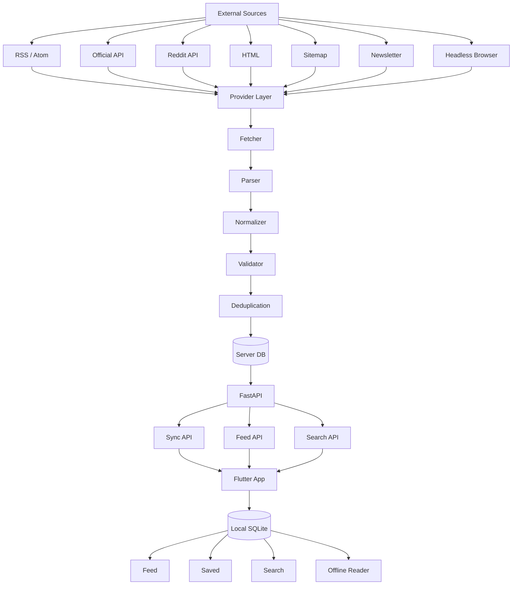
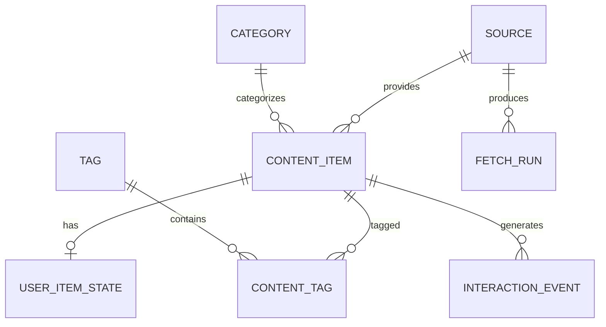
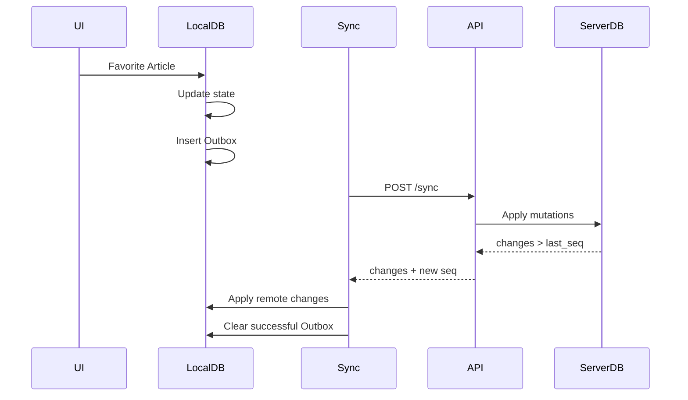

# GameDev 内容聚合阅读 App
## Project Specification / Architecture / Implementation Guide

> 项目目标：构建一个仅供个人长期使用的、跨平台的 GameDev 内容聚合阅读工具。
>
> 产品形态参考“小黑盒 / Reddit / 知乎 / 新闻客户端”的信息流体验，但不做社区，不做用户社交，不做复杂平台能力。
>
> 核心目标不是“做一个 RSS Reader”，而是：
>
> **把分散在不同 GameDev 网站、论坛、博客、API、RSS、Newsletter 中的内容，标准化为一个统一、可同步、可搜索、可离线阅读、未来可推荐和 AI 增强的信息流。**

---

# 0. 项目原则

整个项目必须始终遵守以下原则。

## 0.1 单人可维护

这是一个个人长期项目，不是商业互联网平台。

避免：

- 微服务
- Kafka
- Redis 依赖
- Kubernetes
- 复杂消息队列
- 多语言后端
- 过早引入向量数据库
- 过早引入 AI Agent
- 过早引入推荐模型训练

优先：

- 单体应用
- 清晰模块边界
- SQLite
- HTTP API
- 后台定时任务
- Provider 插件机制
- Local-first 客户端

---

## 0.2 先保证内容流，再做智能化

开发顺序必须是：

```text
Source
  ↓
Provider
  ↓
Fetch
  ↓
Normalize
  ↓
Store
  ↓
Feed
  ↓
Read
  ↓
Sync
  ↓
Recommend
  ↓
AI
```

不能反过来。

---

## 0.3 Provider 是核心资产

客户端 UI 不是最难维护的部分。

这个项目真正长期产生维护成本的是：

```text
外部信息源
```

所以：

> Provider / Adapter 层必须从项目第一天就设计正确。

以后增加网站时，理想情况应该是：

```text
新增 Source 配置
```

而不是：

```text
修改整个系统
```

---

# 1. 产品定义

## 1.1 产品定位

这是一个：

> **GameDev 垂直领域的 Personal Information Hub**

不是：

- 社交平台
- 游戏社区
- 普通 RSS 阅读器
- 新闻门户
- 内容发布平台

而是：

```text
GameDev Sources
      ↓
Unified Content Stream
      ↓
Read / Save / Search
      ↓
Preference Learning
      ↓
Personal GameDev Knowledge Hub
```

---

## 1.2 核心价值

用户每天面对的信息源可能包括：

- Game Developer
- GDC
- GDC Vault
- 80 Level
- GameDiscoverCo
- GameRes 游资网
- Epic Developer Community
- GameDev.net
- Reddit r/gamedev
- Handmade Network
- Game Development Stack Exchange
- Red Blob Games
- Gaffer On Games
- How To Market A Game
- Critical Distance
- 游戏葡萄
- indienova

问题在于：

```text
网站很多
格式不同
更新频率不同
账号不同
搜索不同
阅读体验不同
```

本项目的目标是统一为：

```text
一个 Feed
一个 Search
一个 Saved
一个 History
一个 Sync
```

---

# 2. MVP 范围

## 2.1 MVP 必须有

### 内容获取

- RSS / Atom
- API Provider
- HTML Provider
- Reddit Provider
- Source 配置
- 定时抓取
- 去重
- 基本错误恢复

### 客户端

- 首页时间流
- Source 筛选
- Category 筛选
- Article Detail
- 打开原文
- 收藏
- 稍后阅读
- 已读状态
- 阅读历史
- 搜索
- 离线缓存

### 同步

同步：

- 收藏
- 已读状态
- 稍后阅读
- 阅读历史
- Source 配置
- Settings

### 平台

目标：

- Android
- iOS
- Windows
- macOS

---

## 2.2 MVP 不做

第一阶段明确禁止：

- 评论
- 点赞
- 用户发帖
- 私信
- 社交关系
- 社区
- 多用户系统
- 推荐算法
- AI 摘要
- 翻译
- Embedding
- Vector DB
- 自动知识库
- Newsletter
- Headless Browser 大规模使用
- 图片 CDN
- 全站全文归档

---

# 3. 推荐技术栈

## 3.1 Client

```text
Flutter
Dart
Riverpod
go_router
Drift
SQLite
Dio
json_serializable
Freezed
```

职责：

```text
UI
Local Database
Offline State
Sync Engine
Feed Presentation
Search
User Interactions
```

---

## 3.2 Server

```text
Python 3.12+
FastAPI
Pydantic
SQLAlchemy
Alembic
httpx
APScheduler
```

抓取：

```text
feedparser
BeautifulSoup4
lxml
readability-lxml
```

后期：

```text
Playwright
```

---

## 3.3 Server Database

MVP：

```text
SQLite
WAL mode
```

未来：

```text
PostgreSQL
```

迁移条件：

- 数据规模明显增大
- 多 worker 并发写入
- Embedding
- pgvector
- 复杂推荐 Query
- 需要更强全文检索

---

# 4. 总体系统架构



---

# 5. 客户端信息架构

## 5.1 一级导航

移动端建议：

```text
Home
Explore
Saved
Search
```

---

## 5.2 Home

未来支持：

```text
For You
Latest
Following
```

MVP 只实现：

```text
Latest
```

排序：

```text
published_at DESC
```

---

## 5.3 Explore

包括：

```text
Categories
Topics
Sources
```

---

## 5.4 Saved

包括：

```text
Favorites
Read Later
History
```

---

## 5.5 Search

MVP 搜索字段：

```text
title
summary
author
source
tag
```

本地建议使用：

```text
SQLite FTS5
```

---

# 6. Feed Card 设计

Feed Card 优先展示：

```text
Source
Category / Tags

Title

Summary

Cover Image

Reading Time
Published Time

Favorite
Read Later
```

不要把 RSS Reader 的概念暴露给最终 UI。

不要显示：

```text
Feed URL
Unread Count
Folder Tree
```

主界面应该是 Content-centric。

---

# 7. 内容获取优先级

所有 Source 优先采用：

```text
Official API
    ↓
RSS / Atom
    ↓
Public JSON Endpoint
    ↓
HTML
    ↓
Sitemap
    ↓
Headless Browser
```

Headless Browser 永远作为 fallback。

---

# 8. Source 模型

建议数据库模型：

```text
Source
```

字段：

```text
id
name
slug

provider_type

homepage_url
icon_url

enabled

default_category_id

config_json

fetch_interval_seconds

last_fetched_at
last_success_at

consecutive_failures
last_error

created_at
updated_at
```

---

# 9. Provider 架构

## 9.1 核心思想

不要设计成：

```text
if source == "80level":
if source == "gameres":
if source == "reddit":
```

而应该：

```text
Provider Registry
        ↓
Provider Instance
        ↓
Source Config
```

---

# 10. Provider 分类

## 10.1 Generic Providers

```text
RSSProvider
AtomProvider
GenericHTMLProvider
SitemapProvider
```

---

## 10.2 Platform Providers

```text
RedditProvider
StackExchangeProvider
DiscourseProvider
SubstackProvider
```

---

## 10.3 Site-specific Providers

特殊站点才实现：

```text
GDCProvider
SpecialSiteProvider
```

---

# 11. Source Adapter 接口

Python 伪代码：

```python
from abc import ABC, abstractmethod

class SourceAdapter(ABC):

    @abstractmethod
    async def discover(self, source, cursor=None):
        ...

    @abstractmethod
    async def fetch_detail(self, raw_item):
        ...

    @abstractmethod
    async def normalize(self, raw_item):
        ...

    async def health_check(self):
        return True
```

---

# 12. Provider 不应该负责什么

Provider 不负责：

```text
数据库事务
Feed 排序
推荐
UI
用户状态
同步逻辑
```

Provider 只负责：

```text
External Source
      ↓
Normalized Content
```

---

# 13. Provider Registry

示意：

```python
PROVIDER_REGISTRY = {
    "rss": RSSProvider,
    "reddit": RedditProvider,
    "stackexchange": StackExchangeProvider,
    "html": GenericHTMLProvider,
    "sitemap": SitemapProvider,
}
```

创建 Provider：

```python
provider_cls = PROVIDER_REGISTRY[source.provider_type]
provider = provider_cls(source.config)
```

---

# 14. 配置驱动的 Provider

尽量让简单网站通过配置接入。

例如：

```yaml
name: Example Blog
slug: example-blog

provider:
  type: html

discovery:
  url: https://example.com/blog

selectors:
  list_item: ".article-card"
  title: ".article-title"
  url: "a"
  summary: ".summary"
  cover: "img"
  published_at: "time"

fetch:
  interval: 3600
```

目标：

> 新增普通网站时尽量不修改 Python 代码。

---

# 15. ContentItem 数据模型

核心实体不要叫 Article。

建议：

```text
ContentItem
```

因为未来内容类型包括：

```text
ARTICLE
POST
QUESTION
DISCUSSION
VIDEO
NEWSLETTER
```

---

# 16. ContentItem 字段

```text
id

source_id
external_id

content_type

title
summary

content_html
content_text

canonical_url
source_url

author
author_url

cover_url

language

published_at
updated_at
fetched_at

reading_time_minutes

url_hash
content_hash

raw_metadata_json

parser_version

created_at
updated_at
```

---

# 17. 为什么允许 content 为空

不是所有网站都应该保存全文。

例如：

```text
title
summary
url
```

可能已经足够。

所以：

```text
content_html
content_text
```

必须 nullable。

---

# 18. User State 与 Content 分离

不要在 ContentItem 里放：

```text
favorite
read
read_later
```

这些属于用户状态。

建立：

```text
UserItemState
```

---

# 19. UserItemState

字段：

```text
id

content_id

favorite
read_later
read_status

reading_progress

first_opened_at
last_opened_at

favorite_updated_at
read_updated_at
read_later_updated_at

created_at
updated_at
```

---

# 20. InteractionEvent

推荐系统暂时不实现，但应该从 MVP 开始记录行为。

事件：

```text
OPEN
READ_25
READ_50
READ_90
FAVORITE
UNFAVORITE
READ_LATER
REMOVE_READ_LATER
OPEN_SOURCE
OPEN_ORIGINAL
```

字段：

```text
id
content_id
event_type
metadata_json
created_at
```

---

# 21. Category

字段：

```text
id
name
slug
description
```

建议初始 Category：

```text
Programming
Graphics
Engine
Game Design
Tools
AI
Indie
Business
Marketing
Industry
Audio
Production
```

---

# 22. Tag

字段：

```text
id
name
slug
```

例：

```text
Unreal Engine
Unity
Godot
C++
Rendering
Nanite
Lumen
Steam
Indie
Shader
Networking
AI
Procedural Generation
```

---

# 23. ContentTag

多对多：

```text
content_id
tag_id
```

---

# 24. 数据库关系



---

# 25. FetchRun

用于抓取监控。

字段：

```text
id
source_id

started_at
finished_at

status

items_discovered
items_created
items_updated
items_skipped

error_type
error_message
```

status：

```text
RUNNING
SUCCESS
PARTIAL
FAILED
```

---

# 26. 抓取 Pipeline

完整 Pipeline：

```text
Source
  ↓
Scheduler
  ↓
Provider
  ↓
Discovery
  ↓
Fetcher
  ↓
Parser
  ↓
Normalizer
  ↓
Validator
  ↓
Deduplication
  ↓
Repository
  ↓
Database
```

---

# 27. Scheduler

职责：

```text
检查哪些 Source 到期
创建 FetchRun
调用 Provider
记录成功失败
更新 Source 状态
```

Source 自己定义：

```text
fetch_interval_seconds
```

推荐示例：

```text
Reddit       900
News         1800
Blog         7200
Static Blog  21600
```

---

# 28. Fetcher

Fetcher 必须独立。

职责：

```text
HTTP GET
Headers
User-Agent
Timeout
Retry
ETag
Last-Modified
Compression
Rate Limit
```

接口：

```python
class Fetcher:

    async def get(
        self,
        url: str,
        headers: dict | None = None
    ) -> FetchResponse:
        ...
```

---

# 29. HTTP Cache

Source 保存：

```text
etag
last_modified
```

请求发送：

```http
If-None-Match
If-Modified-Since
```

收到：

```text
304 Not Modified
```

则跳过解析。

---

# 30. Parser

Parser 负责：

```text
Raw HTTP Response
        ↓
Structured Provider Item
```

不能：

```text
直接写 DB
```

---

# 31. Normalizer

所有 Provider 最终输出统一模型：

```python
NormalizedContentItem
```

示意：

```python
class NormalizedContentItem(BaseModel):
    source_id: str
    external_id: str | None

    content_type: str

    title: str
    summary: str | None

    content_html: str | None
    content_text: str | None

    canonical_url: str
    source_url: str | None

    author: str | None
    author_url: str | None

    cover_url: str | None

    language: str | None

    published_at: datetime | None
    updated_at: datetime | None

    raw_metadata: dict
```

---

# 32. Validator

最少检查：

```text
title != empty
canonical_url valid
source_id exists
published_at valid
```

无效数据：

```text
skip + log
```

不能导致整个 Source 抓取失败。

---

# 33. Deduplication

MVP 两层。

## 第一层

```text
(source_id, external_id)
```

如果 external_id 有值。

---

## 第二层

```text
canonical_url_hash
```

---

未来：

```text
content_hash
embedding similarity
```

---

# 34. URL Normalization

统一去掉：

```text
utm_source
utm_medium
utm_campaign
ref
fbclid
gclid
```

保留真正影响内容的 query 参数。

例如：

```text
https://example.com/a?utm_source=twitter
```

归一化：

```text
https://example.com/a
```

---

# 35. 内容更新策略

如果：

```text
same canonical_url
```

但：

```text
content_hash changed
```

更新：

```text
summary
content
updated_at
cover
```

不要新建 Article。

---

# 36. Source Failure

Source 保存：

```text
consecutive_failures
last_success_at
last_error
```

推荐策略：

```text
1 failure
正常等待下一轮

3 failures
延长 interval

10 failures
标记 degraded
```

---

# 37. Parser 版本

HTML Provider 必须记录：

```text
parser_version
```

例如：

```text
gameres-v1
gameres-v2
```

方便未来排查：

```text
什么时候开始解析坏了
```

---

# 38. Parser Fixture Tests

目录：

```text
tests/
  fixtures/
    gameres/
      list.html
      article.html

    80level/
      list.html
```

测试：

```python
def test_gameres_parser():
    html = load_fixture(...)
    items = parser.parse(html)

    assert len(items) > 0
    assert items[0].title
    assert items[0].url
```

---

# 39. Reddit Provider

独立 Provider：

```text
RedditProvider
```

输入：

```text
subreddit
sort
limit
```

例如：

```yaml
provider:
  type: reddit

config:
  subreddit: gamedev
  sort: new
  limit: 50
```

输出：

```text
POST
DISCUSSION
```

---

# 40. RSS Provider

应支持：

```text
RSS 2.0
Atom
```

映射：

```text
entry.title       -> title
entry.link        -> canonical_url
entry.summary     -> summary
entry.author      -> author
entry.published   -> published_at
entry.content     -> content_html
```

---

# 41. Generic HTML Provider

配置：

```yaml
list:
  url: https://example.com/articles

selectors:
  item: ".post"

fields:
  title:
    selector: ".title"

  url:
    selector: "a"
    attr: href

  summary:
    selector: ".excerpt"

  cover:
    selector: "img"
    attr: src
```

---

# 42. Sitemap Provider

只负责：

```text
URL Discovery
```

流程：

```text
sitemap.xml
   ↓
URL
   ↓
HTML Detail Fetcher
   ↓
Normalizer
```

---

# 43. Headless Browser

MVP 不实现。

未来 Provider：

```text
BrowserProvider
```

基于：

```text
Playwright
```

只有满足以下条件才使用：

```text
没有 API
没有 RSS
普通 HTTP 无法获得内容
页面必须 JS 渲染
```

---

# 44. 图片策略

MVP：

```text
只保存 cover_url
```

客户端：

```text
HTTP image cache
```

暂时不：

```text
服务器下载
重新上传
生成 CDN
```

---

# 45. 服务端 API

建议 REST。

Base：

```text
/api/v1
```

---

# 46. Feed API

```http
GET /api/v1/feed
```

Query：

```text
cursor
limit
source_id
category_id
tag
```

返回：

```json
{
  "items": [],
  "next_cursor": "..."
}
```

推荐使用 cursor pagination。

不要 offset pagination。

---

# 47. Article API

```http
GET /api/v1/content/{id}
```

---

# 48. Source API

```http
GET /api/v1/sources

POST /api/v1/sources

PATCH /api/v1/sources/{id}

DELETE /api/v1/sources/{id}
```

个人项目可以不做复杂权限。

---

# 49. Search API

```http
GET /api/v1/search?q=nanite
```

过滤：

```text
source
category
tag
date
```

---

# 50. Sync API

核心：

```http
POST /api/v1/sync
```

请求：

```json
{
  "device_id": "...",
  "last_server_seq": 120,
  "mutations": []
}
```

响应：

```json
{
  "server_seq": 153,
  "changes": []
}
```

---

# 51. Sync 模型

客户端：

```text
Local DB
   ↓
Outbox
   ↓
Sync Engine
   ↓
Server
```

---

# 52. Outbox

表：

```text
id
mutation_id

entity_type
entity_id

operation

payload_json

created_at
retry_count
last_error
```

例如：

```json
{
  "entity_type": "user_item_state",
  "entity_id": "article-123",
  "operation": "patch",
  "payload": {
    "favorite": true
  }
}
```

---

# 53. ChangeLog

服务器维护：

```text
seq
entity_type
entity_id
operation
payload_json
created_at
```

seq 单调递增。

客户端记录：

```text
last_server_seq
```

---

# 54. Sync Flow



---

# 55. 冲突处理

个人单用户项目：

```text
Last Write Wins
```

但应该 field-level。

例如：

```text
favorite_updated_at
read_updated_at
read_later_updated_at
```

避免：

```text
手机收藏
电脑已读
互相覆盖
```

---

# 56. 本地数据库

Flutter 使用：

```text
Drift + SQLite
```

UI 只能读本地 DB。

不要让 Widget 直接依赖网络请求。

推荐：

```text
Remote API
   ↓
Repository
   ↓
Local DB
   ↓
Riverpod
   ↓
UI
```

---

# 57. Local-first

原则：

```text
UI always reads Local DB
```

网络负责：

```text
更新 Local DB
```

而不是：

```text
UI
 ↓
HTTP
 ↓
Server
```

---

# 58. Flutter Architecture

推荐 feature-first。

```text
lib/

  app/

  core/
    database/
    network/
    sync/
    routing/
    theme/

  features/

    feed/
    content/
    search/
    saved/
    sources/
    settings/
```

---

# 59. Flutter Feature 结构

例如：

```text
features/feed/

  data/
    feed_repository.dart

  domain/
    feed_item.dart

  presentation/
    feed_page.dart
    feed_controller.dart
    widgets/
```

不要严格套大型 Clean Architecture。

只保持：

```text
data
domain
presentation
```

足够。

---

# 60. Riverpod

Provider 示例：

```text
feedRepositoryProvider
feedControllerProvider
favoriteControllerProvider
syncEngineProvider
```

不要在 Widget 中写复杂业务逻辑。

---

# 61. Desktop Layout

桌面：

```text
Sidebar
   |
Feed List
   |
Preview / Detail
```

布局：

```text
┌────────────┬────────────────────┬─────────────────┐
│ Sidebar    │ Feed               │ Preview         │
│            │                    │                 │
│ Home       │ Article            │ Article Detail  │
│ Explore    │ Article            │                 │
│ Saved      │ Article            │                 │
│ Search     │                    │                 │
└────────────┴────────────────────┴─────────────────┘
```

---

# 62. Mobile Layout

单栏：

```text
Feed
```

点击进入：

```text
Detail
```

Bottom Navigation：

```text
Home
Explore
Saved
Search
```

---

# 63. Desktop Keyboard

未来可以支持：

```text
J    next
K    previous
Enter open
S    save
F    favorite
O    open original
```

不属于 MVP blocker。

---

# 64. Search

MVP：

```text
SQLite FTS5
```

索引：

```text
title
summary
content_text
author
```

---

# 65. Feed Ranking

MVP：

```sql
ORDER BY published_at DESC
```

不要提前设计复杂排序。

---

# 66. Recommendation Phase 2

记录：

```text
source affinity
tag affinity
category affinity
recency
engagement
seen penalty
```

基础评分：

$$
Score =
w_1R +
w_2S +
w_3T +
w_4C +
w_5E -
w_6P
$$

其中：

```text
R = Recency
S = Source Affinity
T = Tag Affinity
C = Category Affinity
E = Engagement
P = Seen Penalty
```

---

# 67. Recommendation Phase 3

未来：

```text
Article
  ↓
Embedding
  ↓
Vector

User History
  ↓
Interest Vector

Cosine Similarity
```

再与规则分融合。

---

# 68. AI 功能 Roadmap

优先级：

```text
1 Auto Tagging
2 Summary
3 Translation
4 Daily Digest
5 Similar Articles
6 Semantic Search
7 Article Q&A
8 Knowledge Base Export
```

---

# 69. AI 不应该第一阶段做

禁止：

```text
对所有文章自动调用 LLM
```

原因：

```text
成本高
大量无价值内容
延迟
维护复杂
```

---

# 70. AI Summary

Trigger：

```text
user opens
user favorites
daily digest candidate
top recommendation
```

然后：

```text
generate
cache
```

---

# 71. Daily Digest

未来：

```text
Today's GameDev
```

结构：

```text
Top 5

Rendering

Unreal Engine

Indie

Industry

Marketing
```

---

# 72. Knowledge Base

后期支持导出：

```text
Markdown
```

例如：

```markdown
---
title:
source:
url:
tags:
date:
---

# Summary

# Key Ideas

# Technical Details

# Related Topics
```

用于：

```text
Obsidian
```

---

# 73. 法律 / ToS 原则

默认优先：

```text
API
RSS
Metadata
```

避免：

```text
绕过登录
绕过付费墙
绕过 DRM
高频抓取
全文永久镜像
```

---

# 74. robots.txt

robots.txt 作为：

```text
Crawler Guidance
```

不是法律授权。

Crawler 应：

```text
尊重 robots
尊重 ToS
设置合理 User-Agent
设置低频请求
```

---

# 75. Metadata-first

默认保存：

```text
title
summary
author
url
source
cover_url
published_at
tags
```

全文视 Source 而定。

---

# 76. 原网站跳转

Article Detail 必须有：

```text
Open Original
```

原文始终作为最终来源。

---

# 77. Server Deployment

MVP：

```text
Docker Compose
```

服务：

```text
api
worker
```

数据库：

```text
SQLite volume
```

前置：

```text
Caddy
```

---

# 78. Docker Compose

概念：

```text
services:

  api
    FastAPI

  worker
    Scheduler + Ingestion

volume:
  database
```

暂时不要：

```text
Redis
Celery
RabbitMQ
```

---

# 79. Worker

初期可以：

```text
APScheduler
```

运行：

```text
fetch_due_sources()
```

未来需要时再拆。

---

# 80. Logging

推荐：

```text
structured logging
```

至少包含：

```text
source_id
provider
fetch_run_id
url
elapsed
status
error
```

---

# 81. Observability

MVP 只需要：

```text
logs
fetch_runs
source status
```

不用 Prometheus / Grafana。

---

# 82. Repository Layout

推荐 Monorepo：

```text
gamedev-feed/

├── apps/
│   └── reader/
│       ├── lib/
│       │   ├── app/
│       │   ├── core/
│       │   │   ├── database/
│       │   │   ├── network/
│       │   │   ├── sync/
│       │   │   ├── routing/
│       │   │   └── theme/
│       │   │
│       │   └── features/
│       │       ├── feed/
│       │       ├── content/
│       │       ├── search/
│       │       ├── saved/
│       │       ├── sources/
│       │       └── settings/
│       │
│       └── test/
│
├── server/
│   ├── app/
│   │   ├── main.py
│   │   ├── config.py
│   │   │
│   │   ├── api/
│   │   │   ├── feed.py
│   │   │   ├── content.py
│   │   │   ├── search.py
│   │   │   ├── sources.py
│   │   │   └── sync.py
│   │   │
│   │   ├── models/
│   │   ├── schemas/
│   │   ├── repositories/
│   │   ├── services/
│   │   ├── sync/
│   │   └── database/
│   │
│   ├── ingestion/
│   │   ├── pipeline.py
│   │   ├── fetcher.py
│   │   ├── normalizer.py
│   │   ├── validator.py
│   │   ├── dedup.py
│   │   │
│   │   ├── providers/
│   │   │   ├── base.py
│   │   │   │
│   │   │   ├── generic/
│   │   │   │   ├── rss.py
│   │   │   │   ├── html.py
│   │   │   │   └── sitemap.py
│   │   │   │
│   │   │   ├── platforms/
│   │   │   │   ├── reddit.py
│   │   │   │   └── stackexchange.py
│   │   │   │
│   │   │   └── sites/
│   │   │
│   │   └── scheduler/
│   │       └── scheduler.py
│   │
│   └── tests/
│       └── fixtures/
│
├── configs/
│   └── sources/
│
├── contracts/
│   └── openapi/
│
├── infra/
│   ├── docker/
│   └── docker-compose.yml
│
├── scripts/
│
├── docs/
│
├── README.md
└── pyproject.toml
```

---

# 83. 不需要 shared 源码目录

不要试图：

```text
Python
和
Dart
```

共享代码。

只共享：

```text
API Contract
```

方式：

```text
FastAPI
   ↓
OpenAPI
   ↓
Dart Client
```

---

# 84. API Contract

Server 作为 Schema Source of Truth。

流程：

```text
Pydantic Models
   ↓
FastAPI OpenAPI
   ↓
Generated Dart API Client
```

---

# 85. Config

`.env`：

```text
DATABASE_URL
USER_AGENT
REDDIT_CLIENT_ID
REDDIT_CLIENT_SECRET
LOG_LEVEL
```

Source 不放 `.env`。

Source 配置放：

```text
configs/sources/
```

---

# 86. Source Config 示例

```yaml
id: redblobgames

name: Red Blob Games

provider:
  type: rss

config:
  feed_url: https://example.com/feed.xml

category: programming

enabled: true

fetch:
  interval_seconds: 21600
```

---

# 87. Coding Conventions

Python：

```text
ruff
mypy
pytest
```

Flutter：

```text
flutter analyze
flutter test
```

禁止：

```text
超大函数
跨层调用
Provider 直接写数据库
Widget 直接发 HTTP
```

---

# 88. Error Model

统一异常：

```text
FetchError
ParseError
NormalizeError
ValidationError
RateLimitError
ProviderError
```

Provider failure 不能 crash worker。

---

# 89. Retry

网络：

```text
max 3 retries
```

推荐：

```text
1s
3s
9s
```

指数退避。

不要 retry：

```text
404
parser error
validation error
```

---

# 90. Rate Limit

Source Config 支持：

```text
min_request_interval
max_requests_per_run
```

---

# 91. Security

因为只有个人使用：

MVP 可以：

```text
single API token
```

Header：

```http
Authorization: Bearer <token>
```

不用 OAuth。

---

# 92. Device ID

每个客户端首次启动生成：

```text
UUID
```

保存：

```text
device_id
```

用于 sync。

---

# 93. Article Detail

两种模式：

## Metadata Mode

```text
Title
Summary
Cover
Source
Tags
Open Original
```

## Reader Mode

只有有可靠全文时：

```text
content_html
```

---

# 94. Offline

本地至少保存：

```text
recent feed
favorite
read later
history
```

后期可以：

```text
Download for Offline
```

---

# 95. Cache Policy

默认：

```text
最近 30 天 feed
```

Favorite / Read Later：

```text
永久保留
```

可配置。

---

# 96. Milestone 0：Ingestion 技术验证

## 目标

证明：

```text
不同 Source
   ↓
统一 ContentItem
```

可行。

---

## 实现

只写：

```text
Python CLI
```

Provider：

```text
RSSProvider
StackExchangeProvider
GenericHTMLProvider
```

Database：

```text
SQLite
```

---

## CLI

目标：

```bash
python -m server.ingestion.cli fetch-all
```

输出：

```text
Fetching Red Blob Games...
18 discovered
16 new
2 duplicated

Fetching StackExchange...
50 discovered
43 new
7 duplicated
```

---

## 完成标准

数据库至少存在：

```text
100+
```

条统一 ContentItem。

来自：

```text
RSS
API
HTML
```

三类来源。

---

## 暂时不要做

```text
Flutter
FastAPI
Sync
AI
Recommendation
Mobile
```

---

# 97. Milestone 1：Desktop Reader

实现：

```text
Flutter
Windows/macOS
```

功能：

```text
Feed
Article Detail
Favorite
Read Later
History
Search
Source Filter
```

数据库：

```text
直接读本地 SQLite
```

---

## 完成标准

能够：

```text
连续真实使用
```

而不是只完成 Demo。

---

# 98. Milestone 2：Provider System

增加：

```text
RSSProvider
HTMLProvider
RedditProvider
StackExchangeProvider
SitemapProvider
```

目标 Source：

```text
10~15
```

---

## 完成标准

RSS：

```text
只加 YAML
```

简单 HTML：

```text
尽量只加配置
```

特殊网站：

```text
最多新增 Adapter
```

---

# 99. Milestone 3：Backend

增加：

```text
FastAPI
Server SQLite
Scheduler
API
```

采集全部移到 Server。

---

# 100. Milestone 4：Sync

实现：

```text
Outbox
ChangeLog
Sync API
```

---

## 完成标准

手机收藏：

```text
Article A
```

桌面同步后：

```text
Article A favorite=true
```

---

# 101. Milestone 5：Mobile

目标：

```text
Android
iOS
```

实现：

```text
responsive UI
offline
sync
```

做到这里视为：

> 产品 MVP 完成。

---

# 102. Milestone 6：For You

先不使用 ML。

实现：

```text
Tag Affinity
Source Affinity
Category Affinity
Recency
Read Behavior
```

---

# 103. Milestone 7：AI

依次：

```text
Auto Tag
Summary
Translation
Digest
Embedding
Semantic Search
Q&A
Knowledge Export
```

---

# 104. 第一阶段具体开发顺序

真正开始写代码时：

```text
Step 1
Source Model

Step 2
ContentItem Model

Step 3
SourceAdapter

Step 4
Fetcher

Step 5
RSSProvider

Step 6
Normalizer

Step 7
Deduplicator

Step 8
SQLite Repository

Step 9
CLI

Step 10
StackExchangeProvider

Step 11
GenericHTMLProvider
```

---

# 105. OpenCode 第一批任务

建议直接让 OpenCode 按以下顺序完成。

---

## Task 001

创建：

```text
server/
```

Python 项目。

添加：

```text
FastAPI
SQLAlchemy
Pydantic
httpx
feedparser
beautifulsoup4
lxml
pytest
ruff
mypy
```

注意：

> Milestone 0 暂时不启动 FastAPI，只准备依赖。

---

## Task 002

创建领域模型：

```text
Source
ContentItem
FetchRun
```

先使用 SQLAlchemy。

---

## Task 003

实现：

```text
SourceAdapter
```

抽象基类。

---

## Task 004

实现：

```text
Fetcher
```

支持：

```text
timeout
headers
retry
etag
last-modified
```

---

## Task 005

实现：

```text
RSSProvider
```

输入：

```text
feed_url
```

输出：

```text
NormalizedContentItem[]
```

---

## Task 006

实现：

```text
DedupService
```

规则：

```text
external_id
canonical_url_hash
```

---

## Task 007

实现：

```text
ContentRepository
```

方法：

```text
get_by_external_id()
get_by_url_hash()
upsert()
list_latest()
```

---

## Task 008

实现 CLI：

```bash
python -m server.ingestion.cli fetch-source redblobgames
```

---

## Task 009

Source Config：

```text
configs/sources/*.yaml
```

实现 loader。

---

## Task 010

增加：

```text
3 个 RSS Source
```

验证整个 Pipeline。

---

# 106. Milestone 0 文件结构

第一阶段只需要：

```text
server/

  ingestion/

    cli.py
    pipeline.py
    fetcher.py
    normalizer.py
    dedup.py

    providers/

      base.py

      generic/
        rss.py

  models/

    source.py
    content.py
    fetch_run.py

  repositories/

    source_repository.py
    content_repository.py

  database/

    session.py
    base.py

configs/

  sources/

tests/
```

不要一次创建全部未来目录。

---

# 107. 第一条完整 Vertical Slice

建议第一条链路：

```text
Red Blob Games RSS
       ↓
RSSProvider
       ↓
Fetcher
       ↓
Normalizer
       ↓
Dedup
       ↓
SQLite
```

完成以后：

```sql
SELECT
    title,
    canonical_url,
    published_at
FROM content_items
ORDER BY published_at DESC;
```

能够看到真实数据。

---

# 108. 第二条 Vertical Slice

增加：

```text
Stack Exchange API
```

验证：

```text
API Provider
```

与 RSS 使用完全相同：

```text
NormalizedContentItem
```

---

# 109. 第三条 Vertical Slice

增加一个普通 HTML 网站。

验证：

```text
GenericHTMLProvider
```

---

# 110. Milestone 0 验收条件

必须全部满足：

```text
[ ] SQLite database created

[ ] Source table exists

[ ] ContentItem table exists

[ ] FetchRun table exists

[ ] RSS Provider works

[ ] API Provider works

[ ] HTML Provider works

[ ] Duplicate articles are not recreated

[ ] A failed source does not stop other sources

[ ] Fetch results are logged

[ ] 100+ real items exist
```

满足以后才创建 Flutter App。

---

# 111. OpenCode 使用约束

建议在仓库根目录创建：

```text
AGENTS.md
```

内容核心要求：

```text
Do not introduce new infrastructure unless required.

Prefer the simplest working architecture.

Do not implement future milestones early.

All providers must output NormalizedContentItem.

Providers must not write directly to the database.

UI must read from local SQLite.

Network operations must go through repositories.

Every HTML parser must have fixture tests.

Avoid abstractions before two real implementations require them.
```

---

# 112. Git Strategy

个人项目不需要复杂 Git Flow。

建议：

```text
main
feature/*
fix/*
```

PR 可以省略。

每个 Milestone 打 tag：

```text
v0.1-ingestion
v0.2-reader
v0.3-providers
v0.4-sync
```

---

# 113. 测试策略

必须重点测试：

```text
Provider
Parser
Normalizer
Dedup
Sync
```

UI 测试不是最高优先级。

---

# 114. Unit Test

测试：

```text
URL normalization
hash
RSS mapping
HTML parsing
dedup
sync conflict
```

---

# 115. Integration Test

例如：

```text
fixture RSS
   ↓
Provider
   ↓
Pipeline
   ↓
Temporary SQLite
```

最终 assert：

```text
ContentItem exists
```

---

# 116. 不建议 Snapshot 整个网页

HTML Fixture 尽量保存：

```text
最小可复现结构
```

避免 fixture 太大。

---

# 117. 数据备份

个人系统最重要的是数据不会丢。

Server：

```text
SQLite file
```

每天：

```text
copy database
```

保留：

```text
7 daily
4 weekly
```

即可。

---

# 118. 数据迁移

必须第一天使用：

```text
Alembic
```

不要依赖：

```text
delete database and recreate
```

---

# 119. SQLite 配置

建议：

```text
WAL mode
foreign_keys=ON
busy_timeout
```

---

# 120. Server Startup

未来：

```text
docker compose up -d
```

即完整服务。

---

# 121. 不要引入的技术

MVP 禁止无明确需求引入：

```text
Redis
Celery
RabbitMQ
Kafka
ElasticSearch
Meilisearch
MongoDB
Kubernetes
GraphQL
gRPC
Vector DB
LangChain
Agent Framework
```

---

# 122. 何时允许新增基础设施

必须满足：

> 当前技术已经产生真实瓶颈。

例如：

SQLite：

```text
出现并发写问题
```

才迁移 PostgreSQL。

搜索：

```text
FTS5 不够
```

才考虑 Meilisearch。

任务：

```text
APScheduler 不够
```

才考虑 Celery。

---

# 123. 产品设计原则

最终每天打开 App 时应该是：

```text
打开
 ↓
马上看到值得看的 GameDev 内容
 ↓
浏览
 ↓
收藏
 ↓
阅读
 ↓
退出
```

而不是：

```text
管理 RSS
整理 Folder
清理 unread
```

---

# 124. 长期目标

长期系统最终可以演变为：

```text
GameDev Internet
       ↓
Provider Network
       ↓
Content Database
       ↓
Personal Interest Model
       ↓
AI Enrichment
       ↓
Personal Knowledge Base
```

但每一层都必须建立在前一层稳定的基础上。

---

# 125. 最终 Architecture Decision Record

## ADR-001 Client

选择：

```text
Flutter
```

原因：

```text
Android
iOS
Windows
macOS
单代码库
```

---

## ADR-002 Backend

选择：

```text
FastAPI
```

原因：

```text
crawler
HTML
RSS
AI ecosystem
开发效率
```

---

## ADR-003 Database

MVP：

```text
SQLite
```

未来：

```text
PostgreSQL
```

---

## ADR-004 Client Storage

选择：

```text
Drift + SQLite
```

采用：

```text
Local-first
```

---

## ADR-005 Communication

选择：

```text
REST + JSON
```

---

## ADR-006 Provider

采用：

```text
Plugin / Adapter Architecture
```

所有 Provider 输出：

```text
NormalizedContentItem
```

---

## ADR-007 Deployment

选择：

```text
Docker Compose
```

---

# 126. 现在应该做什么

不要先：

```text
flutter create
```

不要先：

```text
设计首页 UI
```

不要先：

```text
接 AI
```

第一步创建：

```text
server/ingestion/
```

然后完成：

```text
Source
ContentItem
SourceAdapter
Fetcher
RSSProvider
Normalizer
Deduplicator
SQLite Repository
CLI
```

第一阶段最终目标：

```bash
python -m server.ingestion.cli fetch-all
```

输出：

```text
3 sources fetched
143 items discovered
126 items inserted
17 duplicates
0 fatal errors
```

然后打开 SQLite，可以看到统一的数据：

```text
ContentItem
```

当这条最小纵向链路跑通之后，再创建 Flutter Reader。

---

# 127. OpenCode 首个 Prompt

可以直接把下面这段交给 OpenCode：

```text
Read PROJECT_SPEC.md first.

We are currently implementing Milestone 0 only.

Do not implement Flutter, FastAPI endpoints, sync, AI, recommendation,
PostgreSQL, Redis, Celery, Docker deployment or any future milestone.

Your goal is to create the smallest maintainable ingestion vertical slice:

Source
-> Fetcher
-> SourceAdapter
-> RSSProvider
-> Normalizer
-> Deduplication
-> SQLite Repository
-> CLI

Use Python 3.12+, SQLAlchemy, Pydantic, httpx, feedparser and Alembic.

Architecture constraints:

1. Providers must never write directly to the database.
2. Every provider must output the same NormalizedContentItem model.
3. HTTP fetching must be isolated in Fetcher.
4. Deduplication must be isolated in DedupService.
5. Persistence must go through Repository classes.
6. Start with one RSS source.
7. Do not introduce abstractions that are not required by the first vertical slice.
8. Add tests for RSS normalization and deduplication.
9. Keep the code readable enough for one developer to maintain long term.

First inspect the repository.
Then propose the minimal file tree for Milestone 0.
Then implement the vertical slice incrementally.
After each major step, run tests before continuing.
```

---

# 128. Definition of Done

整个项目最终成功的标准不是：

```text
代码很多
架构高级
AI 很多
```

而是：

> **每天打开它，比分别打开 Reddit、Game Developer、80 Level、GameRes、Epic Forum、GameDev.net 更方便。**

只有满足这一点，这个项目才真正成立。
